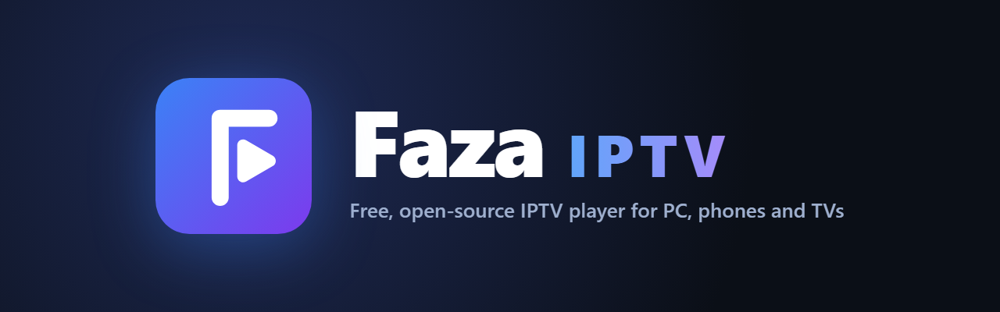
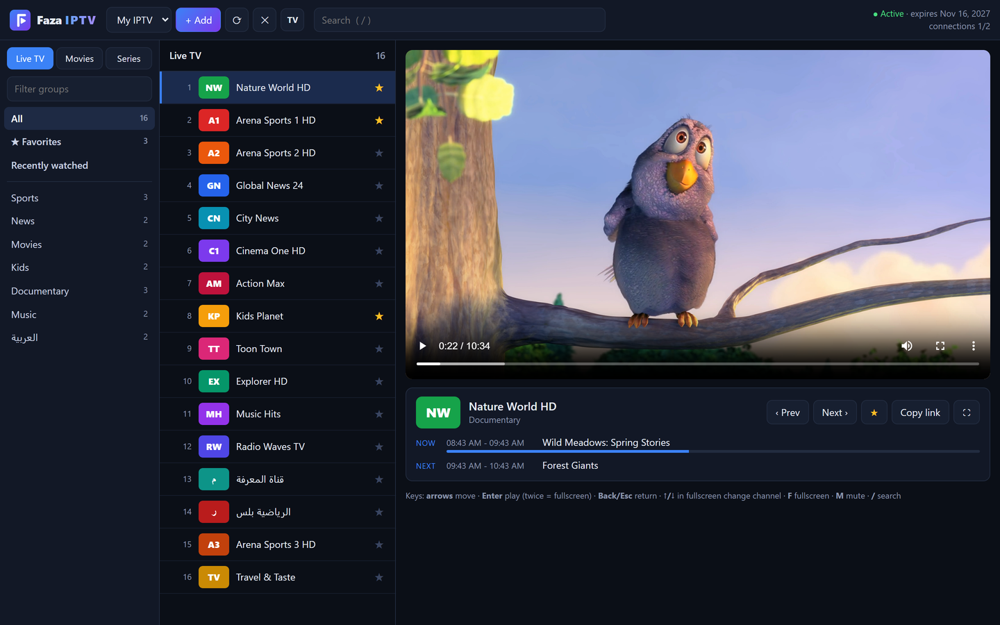
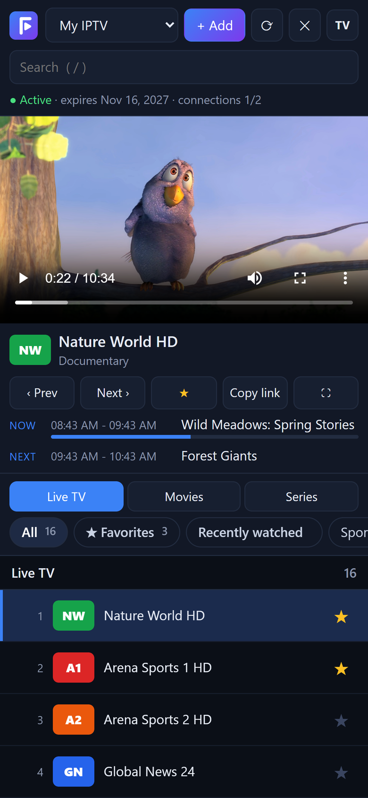
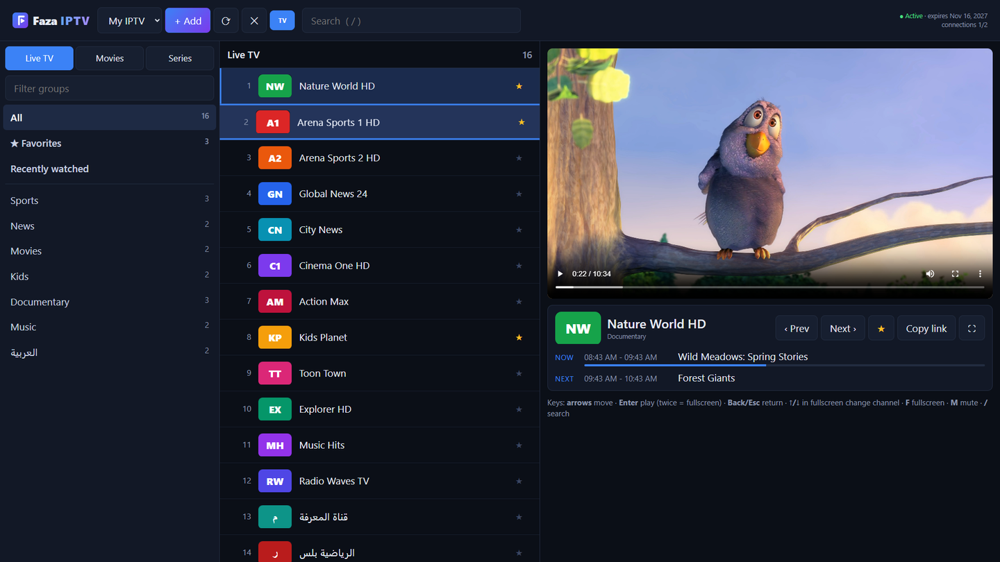

# Faza IPTV



A free, open-source IPTV player for **Windows, macOS, Linux, Android, TVs** and **any phone browser**.
Bring your own playlist: an **Xtream Codes** login (server + username + password) or an **M3U / M3U8** link or file.



<p align="center"></p>

<sub>Screenshots use fictional demo channels; the video is *Big Buck Bunny* © Blender Foundation (CC BY 3.0).</sub>

## Features

- **Xtream Codes**: Live TV, Movies and Series (seasons and episodes), account status and expiry date, and a **Now / Next TV guide**
- **M3U playlists** from a link or a file (`get.php?username=…` links are detected as Xtream automatically)
- Channel groups, fast search across thousands of channels, **favorites** and **recently watched**
- Plays **HLS (.m3u8)**, **MPEG-TS (.ts)**, MP4 and MKV, and falls back automatically between formats
- **TV mode**: big text and full remote-control navigation (arrows, OK, Back, Channel +/-). Turns on automatically on TVs, or press the **TV** button
- Keyboard: arrows move · <kbd>Enter</kbd> play (twice = fullscreen) · <kbd>Esc</kbd> back · <kbd>F</kbd> fullscreen · <kbd>M</kbd> mute · <kbd>/</kbd> search
- Phone-friendly layout that can be installed to the home screen
- Everything stays on your device. No account, no tracking, no ads.

> **No channels are included.** This app is only a player. Use it with playlists and subscriptions you are legally allowed to watch.
> To try it, the *Add* dialog has buttons for free public channels from the [iptv-org](https://github.com/iptv-org/iptv) project.

## Download

Go to **[Releases](../../releases/latest)** and pick your file:

| Device | File |
|---|---|
| Windows (installer) | `Faza-IPTV-Setup-x.y.z.exe` |
| Windows (no install) | `Faza-IPTV-Portable-x.y.z.exe` |
| macOS | `Faza-IPTV-x.y.z-mac.dmg` (first launch: right-click › Open) |
| Linux | `Faza-IPTV-x.y.z-linux.AppImage` or `Faza-IPTV-x.y.z-linux-x64.tar.gz` (extract, run `./faza-iptv`) |
| Android phones & tablets | `Faza-IPTV-x.y.z-android.apk` (allow "install unknown apps") |
| Android TV, Google TV, Fire TV | same `.apk`, see *TVs* below |
| iPhone / iPad, Samsung & LG TVs | use the *hosted version* or *Phone mode* below |

Windows may show "Windows protected your PC" because the app isn't code-signed. Click **More info › Run anyway**.

## TVs

- **Android TV / Google TV / Fire TV**: install the `.apk`. On Fire TV, install the free **Downloader** app, enter the `.apk` link from Releases and install it. On Android TV / Google TV, use *Send files to TV* or a USB stick. Faza IPTV then appears in the TV's app row.
- **Samsung (Tizen) / LG (webOS) / other smart TVs**: open the TV's web browser and go to your *hosted version* address (below). TV mode turns on automatically.
- Remote: arrows move, **OK** plays (OK again = fullscreen), **Back** returns, **Channel +/-** or **Up/Down** in fullscreen changes channel.



## Hosted version (free, always on, any device)

Put your own copy online for free on Cloudflare (always on, no sleeping, servers worldwide). Then any phone, PC or TV browser can use it from anywhere and install it like an app:

1. Make a free account at [dash.cloudflare.com](https://dash.cloudflare.com/sign-up).
2. In the project folder run:
   ```bash
   cd cloudflare
   npx wrangler login                      # opens the browser once
   npx wrangler secret put ACCESS_KEY      # choose your password (long and unique)
   npx wrangler deploy                     # prints your address, e.g. https://faza-iptv.<you>.workers.dev
   ```
3. Open the address, sign in with your password, then **Add to Home Screen** / **Install app**.

Security: everything (app, playlists and streams) sits behind your password. Devices stay signed in with a signed, HttpOnly cookie, so the password never appears in links. Changing `ACCESS_KEY` signs every device out. Your playlists and logins are stored only on each device, never on the server. The relay also refuses requests from other websites, so it can't be borrowed by them.

No password: deploy with `npx wrangler deploy --var REQUIRE_PASSWORD:false` and skip the `secret put` step. Anyone with your link can then open the app, which is fine for family use. Keep the link private, because the free daily request limit is shared by everyone using it.
Free-plan limits: 100,000 requests a day. That is plenty for a household, since one live channel uses about 600 requests an hour.

## Phone mode (iPhone, iPad and any phone on your Wi-Fi)

Run the player on a computer and watch on your phone over the same Wi-Fi:

1. Install [Node.js](https://nodejs.org) on the computer and download this project (*Code › Download ZIP*).
2. Double-click **`Start for phones (same Wi-Fi).bat`** (on Mac/Linux: `node server.js --lan`).
3. The window shows an address like `http://192.168.1.20:8686`. Open it in your phone's browser.
4. Tap **Share › Add to Home Screen** (iPhone) or **⋮ › Install app** (Android).

Allow "Private networks" if the Windows firewall asks.

## Run from source

```bash
npm start            # browser version at http://localhost:8686 (no npm install needed)
npm run phone        # same, but reachable from phones on your Wi-Fi
npm install          # once, then:
npm run desktop      # desktop app (Electron)
npm run dist         # build installers into dist/
bash android/build.sh  # Android APK (needs Java 17 + Android SDK)
```

Pushing a tag like `v1.0.1` makes GitHub Actions build every app and publish a release automatically.

## How it works

Browsers block most IPTV streams (plain `http://` and no CORS headers), so the app runs in one of three modes:

- **Server mode** (`server.js`, zero dependencies): a tiny local server serves the UI and relays playlists and streams. It rewrites HLS playlists so every segment goes through it as well.
- **Hosted mode** (`cloudflare/worker.js`): the same relay running on Cloudflare's network, behind a password.
- **Direct mode** (desktop and Android apps): the UI is loaded from local files inside an app shell that is allowed to reach any server, so no relay is needed.

Playback uses [hls.js](https://github.com/video-dev/hls.js) and [mpegts.js](https://github.com/xqq/mpegts.js) (both Apache-2.0, bundled in `public/vendor`), or the native player on Safari / iPhone.

## Troubleshooting

- **Picture but no sound**: the channel probably uses AC-3/E-AC-3 audio, which browsers can't decode. Use **Copy link** and open it in VLC.
- **HTTP 403 / 458**: the subscription expired or too many devices are connected at once.
- **A channel won't load**: it may be offline. Try *Try again* or the next channel.

## Brand & social media kit

Logos, profile pictures, banners for every platform, post and story images, promo videos and ready-to-post captions (English and Arabic) are in **[`brand/`](brand/)**.

## License

[MIT](LICENSE). Free to use, change and share.
