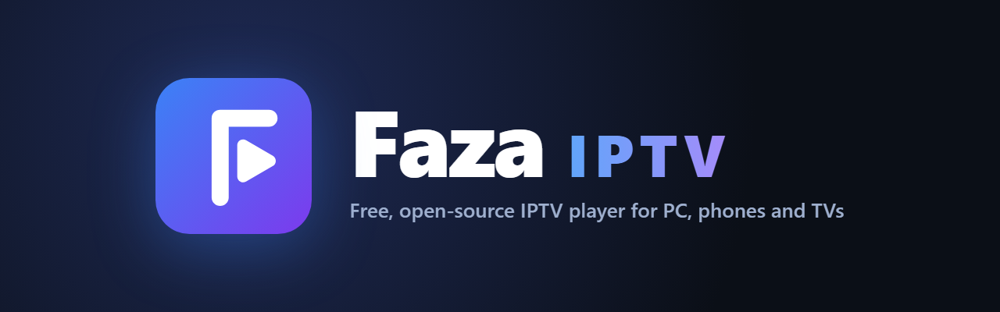

# Faza IPTV brand & social media kit

Everything needed to present Faza IPTV on social media: logos, profile pictures, banners for every platform, post and story images, promo videos and ready-to-post captions ([posts.md](posts.md)).

## Logo

| File | Use it for |
|---|---|
| [`logo/faza-icon.svg`](logo/faza-icon.svg) | Master logo (vector, any size) |
| [`logo/faza-icon-1024.png`](logo/faza-icon-1024.png) | App icon with rounded corners, transparent background |
| [`logo/faza-icon-square-1024.png`](logo/faza-icon-square-1024.png) | Square app-store / favicon source |
| [`logo/profile-picture-1080.png`](logo/profile-picture-1080.png) | Profile picture on every platform (safe for circle crops) |
| [`logo/faza-logo-horizontal-for-dark-bg.png`](logo/faza-logo-horizontal-for-dark-bg.png) | Logo + name on dark backgrounds (transparent PNG) |
| [`logo/faza-logo-horizontal-for-light-bg.png`](logo/faza-logo-horizontal-for-light-bg.png) | Logo + name on white / light backgrounds (transparent PNG) |

The mark is a white **F** whose middle bar is a **play button**: Faza + TV/play. Don't stretch it, recolor it or add effects. Leave space around it equal to the width of the F's stem.

### Colors

| | Hex |
|---|---|
| Blue (gradient start) | `#3B82F6` |
| Violet (gradient end) | `#7C3AED` |
| Sky (text gradient) | `#60A5FA` |
| Lilac (text gradient) | `#A78BFA` |
| Background (night) | `#0B0F17` |

The gradient runs at 135° from blue (top-left) to violet (bottom-right). The name is set in **Segoe UI ExtraBold** (any heavy sans-serif works): "Faza" in white, "IPTV" in the sky→lilac gradient with wide letter spacing.

## Social media sizes

| Platform | File | Size |
|---|---|---|
| YouTube channel banner | [`social/youtube-banner-2560x1440.png`](social/youtube-banner-2560x1440.png) | 2560×1440 (logo kept in the safe area for TV/phone/desktop) |
| X / Twitter header | [`social/x-twitter-header-1500x500.png`](social/x-twitter-header-1500x500.png) | 1500×500 |
| Facebook cover | [`social/facebook-cover-1640x624.png`](social/facebook-cover-1640x624.png) | 1640×624 |
| LinkedIn banner | [`social/linkedin-banner-1584x396.png`](social/linkedin-banner-1584x396.png) | 1584×396 |
| GitHub social preview | [`social/github-social-preview-1280x640.png`](social/github-social-preview-1280x640.png) | 1280×640 (repo *Settings › Social preview*) |
| Instagram / Facebook post | [`social/instagram-post-1080x1080.png`](social/instagram-post-1080x1080.png) | 1080×1080 |
| Instagram carousel (5 slides) | [`social/carousel-1…5-1080x1350.png`](social/) | 1080×1350 |
| Stories (Instagram, Facebook, WhatsApp, Snapchat) | [`social/story-1-1080x1920.png`](social/story-1-1080x1920.png), [`story-2`](social/story-2-1080x1920.png) | 1080×1920 |

## Videos

| File | Use it for |
|---|---|
| [`video/faza-promo-vertical-1080x1920.mp4`](video/faza-promo-vertical-1080x1920.mp4) | Reels, TikTok, YouTube Shorts, Stories (15 s) |
| [`video/faza-promo-landscape-1920x1080.mp4`](video/faza-promo-landscape-1920x1080.mp4) | YouTube, X, Facebook, LinkedIn (15 s) |
| [`video/faza-logo-intro-1080x1080.mp4`](video/faza-logo-intro-1080x1080.mp4) | Animated logo / intro (4 s) |
| [`video/faza-logo-intro.gif`](video/faza-logo-intro.gif) | Animated logo for chats and websites |

The videos are **silent** on purpose: add a trending or royalty-free track inside Instagram, TikTok or YouTube. That gets more reach and avoids music-rights problems.

## Screenshots

[`screenshots/`](screenshots/) has clean product shots for desktop, phone and TV.

## Credits & rules

- Demo footage in screenshots and videos: *Big Buck Bunny* © Blender Foundation, [CC BY 3.0](https://creativecommons.org/licenses/by/3.0/). Keep this credit when you use these files.
- Channel names and logos shown in the app are **fictional**. Never show real broadcasters' channels or footage in Faza IPTV marketing.
- Always say "no channels included / bring your own playlist" in posts.
- [`source/studio.html`](source/studio.html) is the design file all images and videos are rendered from. Edit the text there and re-render with [`source/render.mjs`](source/render.mjs).
